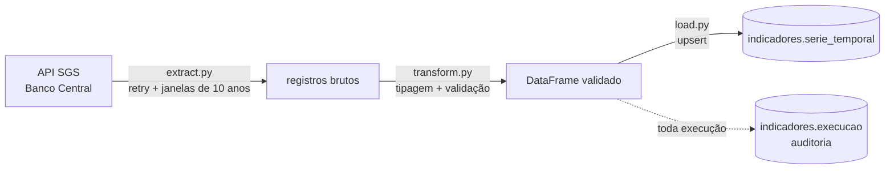

# 📈 Economic Indicators ETL


Pipeline ETL em Python que coleta indicadores econômicos da **API SGS do Banco Central** e grava no PostgreSQL de forma **incremental, idempotente e auditada**.

| Série | Código SGS | Periodicidade |
|---|---|---|
| IPCA (variação % mensal) | 433 | mensal |
| Meta Selic (% a.a.) | 432 | diária |
| Dólar PTAX venda (R$) | 1 | diária |

> **Por que esse projeto?** Para comparar o custo de uma frota ao longo do tempo, preciso tirar o efeito da inflação. Este pipeline mantém o IPCA (e outros indicadores) sempre atualizado num banco, pronto para ser cruzado com os preços de combustível.

Parte 2 de 3 do portfólio **Custo de frota no Brasil**:
1. [fuel-price-warehouse](https://github.com/GustavoCabral22/fuel-price-warehouse): modelagem e SQL
2. **economic-indicators-etl** (este): ingestão em Python
3. [fleet-cost-pipeline](https://github.com/GustavoCabral22/fleet-cost-pipeline): orquestração com Airflow

## Arquitetura



## Como rodar

```bash
cp .env.example .env
make setup      # ambiente virtual + dependências
make up         # PostgreSQL no Docker
make run        # carga incremental de todas as séries
make test       # testes unitários e de integração
```

Uso direto da linha de comando:

```bash
python -m bcb_etl                                    # todas as séries, incremental
python -m bcb_etl --serie ipca                       # só o IPCA
python -m bcb_etl --serie dolar_ptax --desde 2020-01-01   # reprocessa um período
```

## Decisões de engenharia

| Problema | Solução |
|---|---|
| A API do BCB oscila e às vezes devolve erro 5xx | Retry automático com backoff exponencial (`extract.py`) |
| Séries diárias só aceitam consultas de até 10 anos | O período é quebrado em janelas e as respostas são unidas |
| Rodar o pipeline duas vezes não pode duplicar dados | `INSERT ... ON CONFLICT DO UPDATE` com chave `(serie, data)` |
| Buscar tudo de novo a cada execução é desperdício | **Carga incremental:** começa na última data já carregada |
| O BCB revisa valores recentes | A carga incremental volta 45 dias para capturar revisões |
| Dado ruim não pode chegar no banco | Validação de nulos, datas duplicadas e faixa plausível de valores; se falhar, a carga para |
| "O pipeline rodou ontem?" | Tabela `indicadores.execucao` registra toda execução, com sucesso ou erro |
| Adicionar uma série nova | Tabela em formato longo: basta uma linha em `config.py`, sem mudar o banco |

## Estrutura

```
├── src/bcb_etl/
│   ├── config.py      # séries, faixas de validação e parâmetros
│   ├── extract.py     # chamada à API com retry e paginação por janelas
│   ├── transform.py   # tipagem e validação de qualidade
│   ├── load.py        # upsert e auditoria
│   ├── pipeline.py    # regra incremental e orquestração E -> T -> L
│   └── __main__.py    # linha de comando
├── sql/schema.sql
└── tests/             # 15 testes; a API é simulada, o banco é real no CI
```

## Próximos passos

- [ ] Publicar as séries também em Parquet, particionado por série e ano
- [ ] Alertar (e-mail ou Slack) quando uma execução falhar
- [ ] Orquestração com Airflow: feito no [fleet-cost-pipeline](https://github.com/GustavoCabral22/fleet-cost-pipeline)

## Fonte dos dados

[Banco Central do Brasil: Sistema Gerenciador de Séries Temporais (SGS)](https://www3.bcb.gov.br/sgspub/), API pública e gratuita.
